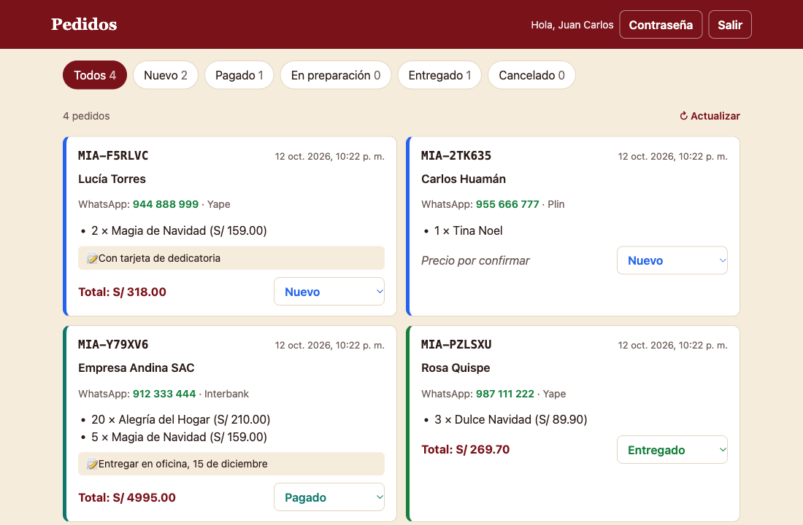

# Canastas MIA · API y panel de pedidos

Backend para el [catálogo navideño de Canastas MIA](https://github.com/juancarlosmendiolamorales-ui/catalogo-canastas-navidad),
un negocio real de canastas en Lima. Guarda los pedidos de los clientes en una base de datos y
da a la dueña un panel con login para seguirlos: nuevo → pagado → en preparación → entregado.



## Cómo funciona

```
 Catálogo (cliente)          API (Node.js + Express)            PostgreSQL
 ──────────────────          ───────────────────────            ──────────
 ver canastas      ──GET───▶ /canastas            ──SQL──▶  canastas, productos
 enviar pedido     ──POST──▶ /pedidos             ──SQL──▶  pedidos, pedido_items
 ver mi pedido     ──GET───▶ /pedidos/:codigo

 Panel (Mia)
 iniciar sesión    ──POST──▶ /admin/login         ──SQL──▶  usuarios, sesiones
 ver / actualizar  ──────▶ /admin/pedidos        ──SQL──▶  pedidos
```

## Rutas de la API

| Método | Ruta | Qué hace | Login |
|---|---|---|---|
| GET | `/canastas` | Lista de canastas visibles con sus productos | No |
| GET | `/canastas/:id` | Una canasta | No |
| POST | `/pedidos` | Crea un pedido y devuelve su código (ej. `MIA-7KQ2PX`) | No |
| GET | `/pedidos/:codigo` | Estado del pedido, sin datos privados del cliente | No |
| POST | `/admin/login` · `/admin/logout` | Iniciar y cerrar sesión | — |
| GET | `/admin/pedidos?estado=` | Todos los pedidos, con filtro por estado | Sí |
| PATCH | `/admin/pedidos/:codigo` | Cambiar el estado de un pedido | Sí |
| POST | `/admin/clave` | Cambiar mi contraseña | Sí |
| — | `/panel` | Panel web (HTML + JavaScript) | Sí |

Ejemplo de pedido:

```json
POST /pedidos
{
  "nombre": "Rosa", "apellido": "Quispe", "celular": "987111222",
  "metodo_pago": "yape",
  "items": [{ "canasta_id": "c1", "cantidad": 3 }]
}
→ 201 { "codigo": "MIA-PZLSXU", "estado": "nuevo", "total": 269.7 }
```

## Decisiones de diseño

- **El precio lo pone el servidor, no el cliente.** El total se calcula con los precios de la base
  de datos; si alguien manda un precio en el pedido, se ignora.
- **Transacciones:** el pedido y sus canastas se guardan juntos o no se guarda nada.
- **El pedido guarda una copia** del nombre y precio de cada canasta, así no cambia si después se
  edita el catálogo.
- **Validación** de todos los datos que llegan (celular peruano, método de pago, cantidades),
  con mensajes de error claros.
- **Consultas parametrizadas** (`$1, $2…`) contra inyección SQL.
- **Contraseñas con scrypt** (hash con sal); nunca se guardan en texto.
- **Sesiones en cookies `HttpOnly` y `SameSite=Strict`**; en la base solo se guarda el hash del token.
- **Bloqueo de 15 minutos** tras 5 intentos de login fallidos, y el mismo mensaje de error si el
  usuario no existe o la clave está mal.
- **El panel nunca inserta HTML** con datos del cliente (usa `textContent`), para evitar XSS.

## Tecnologías

Node.js · Express 5 · PostgreSQL · `pg` · Docker · HTML/CSS/JavaScript sin frameworks · Render · Neon

## Correrlo en tu computadora

Necesitas Node.js 22 o más y Docker.

```bash
cp .env.example .env          # y cambia la contraseña
npm install
npm run db:encender           # enciende PostgreSQL en Docker
npm run db:reiniciar          # crea las tablas y carga las canastas
npm run usuario -- mia "Mia"  # crea una cuenta para el panel y muestra su contraseña
npm run dev                   # http://localhost:3000  ·  panel en /panel
```

## Estructura

```
src/
  servidor.js        arranque y rutas principales
  db.js              conexión a PostgreSQL
  auth.js            contraseñas, sesiones y cookies
  preparar.js        crea tablas y carga canastas (sin borrar nada)
  rutas/             canastas, pedidos y admin
public/panel/        panel web
sql/esquema.sql      tablas
scripts/             reiniciar la base y crear usuarios
```

## Autor

**Juan Carlos Mendiola**, estudiante de Ingeniería de Sistemas en la UPC.
Hecho con ayuda de [Claude Code](https://claude.com/claude-code) como asistente de programación.
